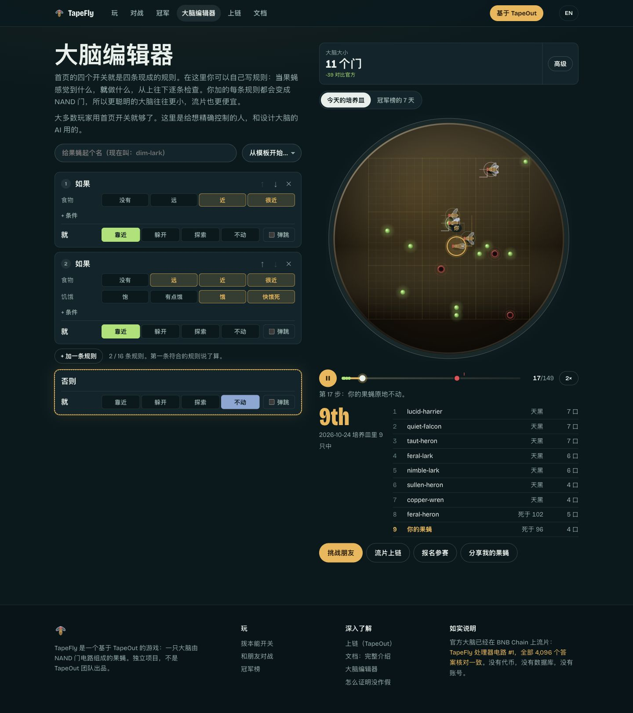
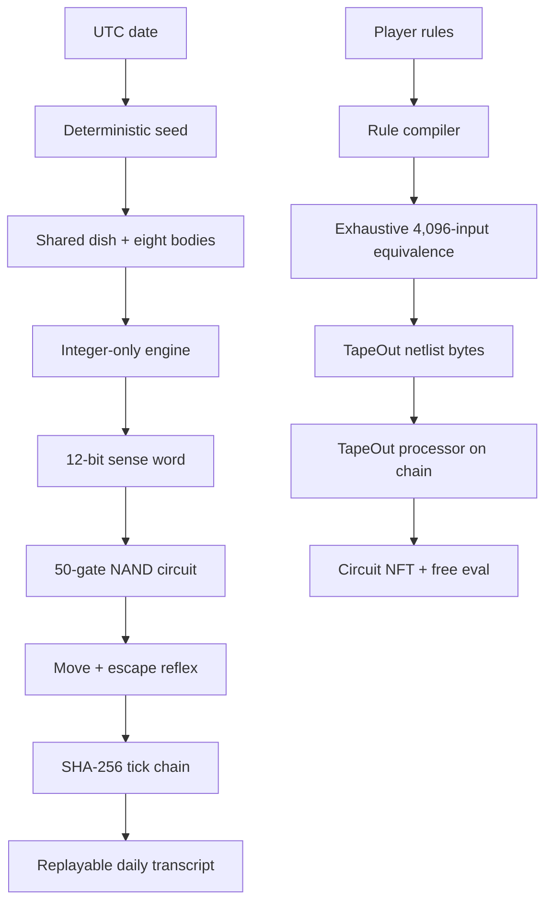
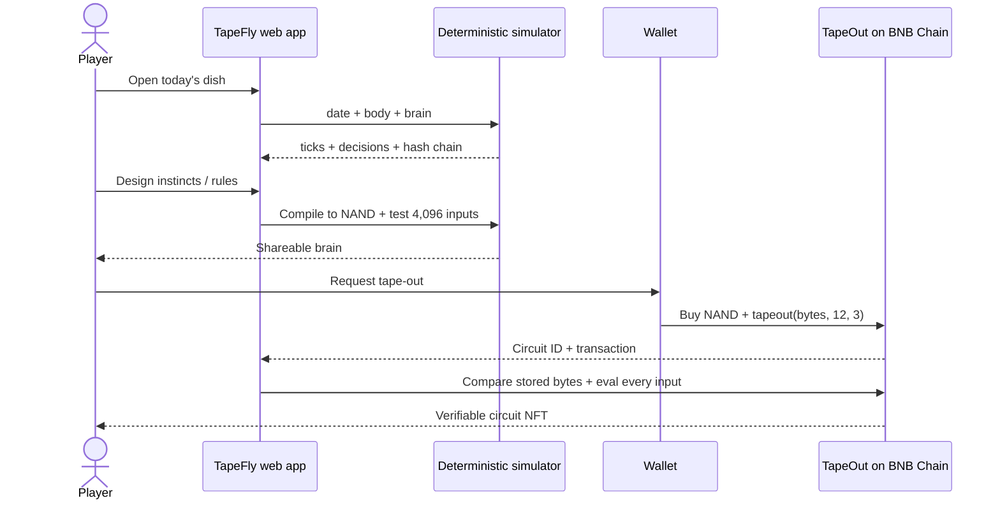

<div align="center">
  <a href="https://tapefly.xyz">
    
  </a>
  <h1>TapeFly</h1>
  <p><strong>A playable fruit fly whose entire brain is 50 NAND gates.</strong></p>
  <p>Deterministic every day. Replayable every tick. Verified on chain.</p>
  <p>
    <a href="https://tapefly.xyz"><strong>Play TapeFly</strong></a> ·
    <a href="https://tapefly.xyz/docs">Docs</a> ·
    <a href="https://tapefly.xyz/tapeout">Circuit #1</a> ·
    <a href="https://tapefly.xyz/agents">Agent API</a>
  </p>
  <p>
    <a href="https://github.com/tapefly/tapefly/actions/workflows/ci.yml"></a>
    <a href="#verification"></a>
    <a href="package.json"></a>
    <a href="https://tapefly.xyz/tapeout"></a>
    <a href="https://tapefly.xyz/api/v1/health"></a>
    <a href="LICENSE"></a>
  </p>
</div>

> **Live status, 24 October 2026.** The official 50-gate brain is TapeOut circuit
> `#1` on BNB Chain. Its stored bytes match the committed netlist, all `4,096`
> possible `eval` answers match, production is HTTPS live, CI is green, and
> `npm audit` reports zero advisories. X Layer circuit deployment is the next
> integration milestone, not a completed claim.

## The 30-second pitch

TapeFly turns a NAND circuit into a living game character. Six senses become a 12-bit input; a 50-gate brain returns a move plus an escape reflex. Because the input space is exactly 4,096 words, there is no hidden black box: every possible decision can be checked in one pass.

The official brain is taped out as **Circuit #1** on BNB Chain. The processor's free read-only `eval` function returned the same answer for every one of the 4,096 inputs, and the stored netlist bytes also match. Players can watch a day unfold, design a new brain, challenge a friend, and tape their own circuit out from their wallet.

No database or account is needed to play or verify a day. A date is the seed, every tick is hashed, and the resulting transcript can be replayed byte for byte.

## For judges

| What | Link or proof |
|---|---|
| Live product | [tapefly.xyz](https://tapefly.xyz) |
| Product documentation | [tapefly.xyz/docs](https://tapefly.xyz/docs) |
| Source code | This repository, MIT licensed |
| TapeOut processor | [`0x6Ac12D578e29D340f178E18eB2C297C7915E011C`](https://bscscan.com/address/0x6Ac12D578e29D340f178E18eB2C297C7915E011C) |
| Transistor contract | [`0x09FD3719f7de0E6FB399279fCC890B205895b942`](https://bscscan.com/address/0x09FD3719f7de0E6FB399279fCC890B205895b942) |
| Official brain | Circuit `#1`, 50 NAND gates, depth 9 |
| Tape-out transaction | [`0x573cdc5e1a4bd30dddbb174c53408eea6a0da806b1154e4b0f81fc8c216cb14b`](https://bscscan.com/tx/0x573cdc5e1a4bd30dddbb174c53408eea6a0da806b1154e4b0f81fc8c216cb14b) |
| Full on-chain check | Processor byte match + all 4,096 `eval` answers |
| Player flow | [Play](https://tapefly.xyz) → [Build](https://tapefly.xyz/build) → [Race](https://tapefly.xyz/vs) → [Tape out](https://tapefly.xyz/tapeout) |
| X Layer track | Existing product is live on BNB Chain; X Layer circuit deployment is the next integration milestone |
| One-command judge check | `npm ci && npm run judge:check` |

### Track alignment

| Judging signal | Evidence in TapeFly |
|---|---|
| User value and commercial potential | A free, wallet-less game loop turns the abstract TapeOut circuit market into a character users can understand, customize and share. |
| Innovation | Behaviour itself is the verifiable object: one circuit, one complete truth table, one replayable daily transcript. |
| TapeOut ecosystem use | Real processor, NAND consumption, circuit NFT path, free on-chain `eval`, netlist bytes and verifiable ownership. |
| Completeness and UX | Chinese-first interface, one-screen instinct controls, eight Brain School levels, friend challenges, season board and share links. |
| Lower technical barrier | A player edits rules rather than gates; the compiler emits TapeOut-compatible NAND bytes automatically. |
| Openness | MIT source, 95 tests, public CI, deterministic ledgers and reproducible on-chain checks. |

## Live proof snapshot

| Property | Verified value |
|---|---|
| Official brain | `FFW-NAND/1` |
| Inputs → outputs | `12 → 3` |
| NAND gates | `50` |
| Circuit depth | `9` |
| Serialized size | `350 bytes` |
| Netlist SHA-256 | `a763117011fe4c4be7106d9b0d2c78fe79b81c15ccc2a6531c9263b4f443d4dd` |
| On-chain circuit | TapeFly processor circuit `#1` |
| Exhaustive check | `4,096 / 4,096` answers identical |
| Stored byte check | Identical |
| Test suite | `95 / 95` passing |

Run the live proof yourself:

```bash
npm ci
npm run verify:onchain
```

The verifier compares the committed 350 bytes with `netlist(1)`, then asks the chain's free read-only `eval(1, input)` function all 4,096 possible inputs.

`npm run judge:check` runs the full local suite and the same live circuit check in
one command. It needs no wallet, private key, token or account.

## Product

<table>
  <tr>
    <td width="50%"></td>
    <td width="50%"></td>
  </tr>
  <tr>
    <td align="center">Turn instincts into a NAND circuit</td>
    <td align="center">Compare brains across a seven-day season</td>
  </tr>
</table>

### One loop, three levels of participation

1. **Watch.** See eight sibling flies share one dish and one brain. Their routes, senses, decisions and deaths are deterministic.
2. **Build.** Flip four instincts or write ordered rules. The compiler tests the result on every possible 12-bit input and emits TapeOut bytes.
3. **Own.** Tape the brain out from a wallet. The new circuit becomes an NFT and can be checked against its committed bytes and complete truth table.

### Product surface

| Route | Purpose |
|---|---|
| `/` | Today's dish, live character simulation and instinct switches |
| `/play` | “Be the fly” tutorial plus eight Brain School levels |
| `/build` | Rule editor → compiled NAND circuit → shareable brain link |
| `/vs` | Two-player challenge with a shared dish and deterministic rounds |
| `/board` | Seven-day season ranking; scores are recomputed from circuits |
| `/calibrate` | 64×64 board showing all 4,096 decisions and disagreements |
| `/verify` | Rebuild a sealed transcript's hash chain in the browser |
| `/lineage` | Champion lineage and optional on-chain anchors |
| `/tapeout` | Buy NAND, simulate, tape out and verify all 4,096 answers |
| `/agents` | Open JSON API for outside agents |

## Architecture



### Runtime sequence



## What makes TapeFly different

| Typical on-chain AI/game project | TapeFly |
|---|---|
| A model or server decides; users trust the output | A 50-gate circuit decides; every possible input can be checked |
| “AI agent” is a broad claim with a hidden runtime | The brain is a small artifact with exact bytes and a complete truth table |
| Game state requires a private database | A date reproduces the public transcript; every tick is hash-chained |
| Users buy an asset without understanding it | Users design a visible rule set, then choose whether to own its circuit |
| Circuit tools require electronics knowledge | Rules compile to TapeOut-compatible NAND gates automatically |

## Verification

```bash
npm ci
npm run typecheck
npm test
npm run lineage -- --check
npm run board -- --check
npm run anchor -- --check
npm run tapeout -- bytes
npm run build
```

`npm run check` runs the complete sequence. CI performs the same checks and additionally asks every official on-chain circuit all 4,096 questions through `eval`.

The committed behavioral certificate compares the official brain with `FLY-LIF/0`, a separate reference implementation of the documented reflex rules. Its current agreement is **85.30%**. This is an internal calibration distance, not a third-party scientific certification.

## Status and boundaries

| Area | State on 2026-10-24 | How to check |
| --- | --- | --- |
| Production site | Live over HTTPS; apex serves the app and `www` redirects to apex | [tapefly.xyz](https://tapefly.xyz) |
| Official brain | Circuit `#1`; bytes and all 4,096 answers verified | [`/tapeout`](https://tapefly.xyz/tapeout) |
| Source and CI | Public, MIT licensed, 95 tests, green GitHub Actions | [Actions](https://github.com/tapefly/tapefly/actions) |
| Dependency security | `npm audit`: 0 vulnerabilities | `npm audit` |
| Daily history | 297 committed UTC days as of 2026-10-24 | [Lineage](https://tapefly.xyz/lineage) |
| Daily BNB Chain anchor | Code and workflow exist; no transaction has been recorded yet | `anchors/anchors.json` |
| X Layer | Not deployed yet; next hackathon integration milestone | `docs/DEMO.md` |
| Token or financial return | No token, yield, dividend or betting mechanic is in this repository | [Docs](https://tapefly.xyz/docs) |

### What the on-chain proof does and does not establish

**It does establish:** the deployed circuit was produced from the committed bytes,
the contract returns the same three-bit answer for every possible 12-bit input,
and anyone can repeat the check through free read-only calls.

**It does not establish:** that the circuit is a full biological connectome, that
the 85.30% reference score is an external scientific certification, that another
player's future brain is correct, or that a circuit has financial value.

These boundaries are part of the product. A smaller true claim is more useful than
a larger claim that cannot be checked.

## Repository map

```text
app/             Next.js app, pages, share cards and open API
sim/             deterministic world, circuits, compiler and ledgers
scripts/         replay, lineage, board, calibration and tape-out tools
tests/           engine, circuit, game, ledger and chain-format tests
config/          committed processor and circuit proof
docs/            architecture, agent protocol, design and fidelity research
challengers/     public brains and frozen season records
anchors/         optional daily lineage anchors
```

## Submission assets

| Asset | Location |
|---|---|
| Live product | [tapefly.xyz](https://tapefly.xyz) |
| Public source | [github.com/tapefly/tapefly](https://github.com/tapefly/tapefly) |
| Product documentation | [tapefly.xyz/docs](https://tapefly.xyz/docs) |
| 3-minute demo script | [docs/DEMO.md](./docs/DEMO.md) |
| VC investment memo | [docs/INVESTOR-MEMO.md](./docs/INVESTOR-MEMO.md) |
| Xccelerate form copy | [docs/XCCELERATE-SUBMISSION.md](./docs/XCCELERATE-SUBMISSION.md) |
| On-chain proof | [TapeOut circuit #1](https://tapefly.xyz/tapeout) |
| API for agents | [tapefly.xyz/agents](https://tapefly.xyz/agents) |

## Local development

Requirements: **Node.js 22**.

```bash
npm ci
npm run dev
```

Open `http://localhost:3000`.

Useful commands:

```bash
npm run replay -- 2026-10-16 --check
npm run lineage -- --check
npm run board -- --show
npm run tapeout -- bytes
npm run verify:onchain
```

Production deployment is documented in [DEPLOY.md](./DEPLOY.md).

## How to enter a brain

1. Open `/build` and create a brain.
2. Export the entry JSON.
3. Add it under `challengers/<github-handle>/<name>.json`.
4. Open a pull request. CI recomputes every score from the circuit.

Netlist JSON and TapeOut hex are accepted as well as rule programs.

## Team

Independent project by **Richard**, built for the TapeOut ecosystem. TapeFly is not an official TapeOut, Binance, OKX or X Layer product.

## Community

- Contributions: [CONTRIBUTING.md](./CONTRIBUTING.md)
- Security reports: [SECURITY.md](./SECURITY.md), preferably through GitHub private vulnerability reporting
- Community standards: [CODE_OF_CONDUCT.md](./CODE_OF_CONDUCT.md)
- Version history: [CHANGELOG.md](./CHANGELOG.md)
- Bugs and ideas: [GitHub Issues](https://github.com/tapefly/tapefly/issues)

## License

[MIT](./LICENSE)
